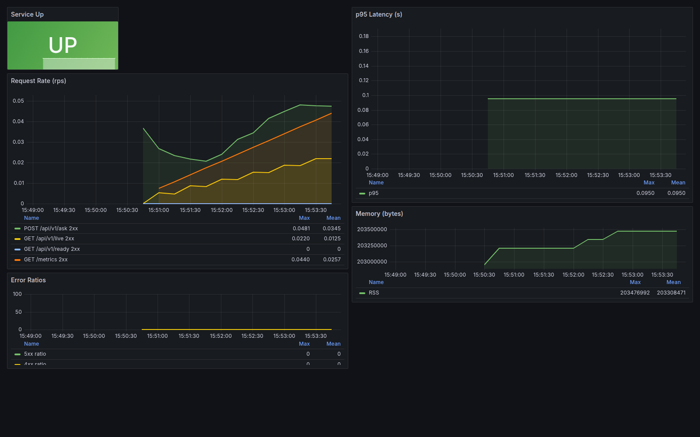
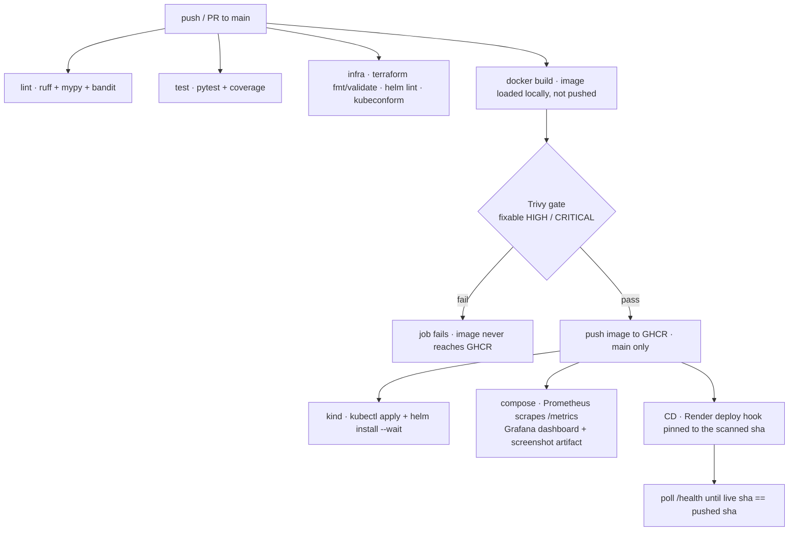

# DevOps Knowledge Assistant: CI/CD, container security and observability

[](https://github.com/Nishant5623/devops-rag-assistant/actions/workflows/ci.yml)
[](https://github.com/Nishant5623/devops-rag-assistant/actions/workflows/cd.yml)
[](https://www.python.org/)
[](LICENSE)
[](Dockerfile)

**A keyless, fully local Retrieval-Augmented Generation (RAG) service over a
DevOps knowledge base** — FastAPI + ChromaDB, wrapped in the infrastructure a
real service needs: a CI/CD pipeline that scans the container image *before* it
ships, Prometheus/Grafana observability, and Kubernetes/Helm packaging. No API
key and no pretrained-model download: it retrieves from its own notes and
answers from them.

**Live demo:** <https://devops-rag-assistant.onrender.com> — free tier, so the
first request after ~15 minutes idle takes 30–60 s to wake (see
[Known limitations](#-known-limitations)).

> Optional: set `ANTHROPIC_API_KEY` to upgrade from extractive answers to
> LLM-synthesized answers. Everything else is identical; the key is not
> required.



*Grafana dashboard from the CI observability job (request rate, p95 latency, error ratios, memory)*

## 🔁 Pipeline



CI runs on every push and PR; the push-to-GHCR, kind, monitoring and CD stages
only run on `main`. The image is built **once** and every downstream check loads
that same image rather than rebuilding it.

## 🚀 Quick start (no API key)

**Full stack with observability (Docker):**

```bash
docker compose up --build
```

- Chat UI: <http://localhost:8000/>
- Prometheus: <http://localhost:9090/> — scrapes the app's protected `/metrics`
- Grafana: <http://localhost:3000/> (admin / admin) — the **DevOps RAG
  Assistant** dashboard is provisioned from the version-controlled files
  in `docker/grafana/`, so it loads on first start

The compose stack defaults `ADMIN_API_KEY` to `dev-admin-key`, and
`docker/prometheus/prometheus.yml` sends that same value as the `X-Admin-Key`
header, so the scrape works out of the box. A keyless
`curl http://localhost:8000/metrics` returns **401**. Change both together.

**Local, no Docker:**

```bash
pip install -r requirements.txt
python -m app.ingest          # build the vector index once
uvicorn app.main:app --reload
```

Open <http://localhost:8000/> for the chat UI or `/docs` for the API UI.

**Standalone Docker:**

```bash
docker build -t devops-rag-assistant .
docker run -p 8000:8000 devops-rag-assistant
```

## 🧠 How it works

```text
                    ┌──────────────────────────────────────────────┐
 data/*.txt ───────▶│  Ingest  (app/ingest.py)                      │
                    │  load → chunk → TF-IDF fit → ChromaDB store   │
                    └──────────────────────────────────────────────┘
                                       ▲
                    ┌──────────────────┴───────────────────────────┐
  question ────────▶│  Retrieve  (app/rag.py)                       │
                    │  embed query → vector search → top-k chunks   │
                    └──────────────────┬───────────────────────────┘
                                       ▼
                    ┌──────────────────┴───────────────────────────┐
                    │  Answer                                       │
                    │  extractive fallback  OR  LLM (Claude, opt-in)│
                    └──────────────────┬───────────────────────────┘
                                       ▼
                              answer + cited sources
```

## 🔌 Endpoints (all under `/api/v1`)

| Method | Path      | Description                                              |
|--------|-----------|----------------------------------------------------------|
| GET    | `/`         | Single-page chat frontend (static files)               |
| GET    | `/api/v1/live`   | Liveness: process is up (**always 200**)           |
| GET    | `/api/v1/health` | Status: commit SHA + build time (**503 until index loaded**) |
| GET    | `/api/v1/ready`  | Readiness: **503 until the index is queryable**    |
| POST   | `/api/v1/ingest` | (Re)build the vector index from `data/` (admin)   |
| POST   | `/api/v1/ask`    | `{"question": "...", "k": 3}` → answer + `found` + cited chunks |
| GET    | `/metrics` | Prometheus metrics (**admin**: `X-Admin-Key`)          |
| GET    | `/docs`    | Interactive OpenAPI / Swagger UI                       |

- `POST /ask` is rate-limited (default **10/min/IP**).
- `POST /ingest` and `/metrics` can be protected with `ADMIN_API_KEY`
  (sent via the `X-Admin-Key` header). Empty key = open (local dev only).
- `question` is validated to 3–500 chars, `k` to 1–10 (422 otherwise).
- `/ask` returns `found: false` — with an explicit *"not in my notes"* answer
  and empty `sources` — whenever the question shares no vocabulary with the
  notes or its best hit is beyond `RELEVANCE_MAX_DISTANCE`. When `found: true`,
  each `sources` entry carries the retrieved `text` chunk, `source` file, and
  `distance`; the chat UI shows every chunk used to form the answer.
- `/health` (root) and `/live` (root) are aliases of `/api/v1/health` and
  `/api/v1/live`, linked from the chat footer alongside `/docs`. `/metrics` is
  **not** linked publicly because it requires the `X-Admin-Key` header.
- Three probes, three jobs: `/live` is pure liveness and always returns 200, so
  Kubernetes never restart-loops a pod that simply has no index yet; `/health`
  reports the exact artifact (`sha` + `build_time`) and returns 503 when the
  index is not loaded; `/ready` returns 503 until the index is queryable, so an
  unusable replica is pulled out of the load balancer instead of serving 400s.

## 🧭 Design decisions

- **Retrieval runs fully local.** TF-IDF embeddings + ChromaDB — no network
  call, no API key, no pretrained-model download. `ANTHROPIC_API_KEY` is an
  optional upgrade, not a dependency.
- **One image, three runtimes.** The same image runs on Docker, on Kubernetes
  (validated on a throwaway kind cluster in CI) and on Render;
  `docker-entrypoint.sh` honours `$PORT` and `$HOST`.
- **One build per pipeline, gate before push.** CI builds the image once, runs
  the Trivy gate on *that* locally-loaded image, and only pushes it if the gate
  passes. The image is saved as an artifact and `docker load`ed — never rebuilt
  — by the `kind` and `monitoring` jobs, so every downstream check exercises the
  bytes that passed the scan.
- **Deploys are pinned to the scanned tag.** CD calls Render with
  `imgURL=…:<pushed-sha>` and then polls `/health` until the live `sha` matches,
  so "deployed" means "the scanned image is answering", not "the hook returned
  200".
- **Probes with three different jobs** (see above): a pod that is still indexing
  is not killed, and a replica that cannot answer is not routed traffic.
- **Self-sufficient replicas.** The chart mounts an `emptyDir` over the
  baked-in index, so each pod rebuilds its own copy (`AUTO_INGEST=True`) instead
  of sharing mutable state; `helm --wait` and `/ready` only succeed once the app
  can actually answer.
- **Honest degradation by default.** With no supporting evidence the app
  returns "not in my notes" and `found: false` rather than guessing. This gate
  is deliberately simple and is *not* a strong content filter — see
  [Known limitations](#-known-limitations).

## ⚠️ Known limitations

These are deliberate, documented trade-offs — not hidden gaps.

- **The relevance gate is weak — keyword overlap is a false-positive magnet.**
  A question is accepted if it shares **any single word** with the notes and its
  best hit is within `RELEVANCE_MAX_DISTANCE=2.0` (which is permissive). Raw
  output from the current corpus:

  | Question | `found` | best distance | top source |
  |---|---|---|---|
  | `How do I deploy a pizza?` | **`true`** (false positive) | 1.57 | `cicd_notes.txt` |
  | `pizza` | `false` | 1.0 | — |
  | `What is the capital of France?` | `false` | 1.0 | — |
  | `How do I bake sourdough bread?` | `false` | 1.0 | — |

  A question with *no* shared tokens is correctly rejected, but one shared token
  ("deploy") is enough to defeat the gate and return CI/CD chunks for a pizza
  question. Tightening this needs semantic (not lexical) retrieval or a stricter
  distance cap; neither is in place today.

- **Free-tier cold starts.** The Render instance sleeps after ~15 minutes idle
  and rebuilds the index on every wake, so the first request can take 30–60 s.
  The chat UI shows a "waking up" state and retries rather than failing.

- **Trivy gate scope.** The gate **fails on fixable HIGH/CRITICAL** CVEs;
  unfixed findings are tracked (the `ignore-unfixed` input is explicit in the
  workflow), not ignored silently. MEDIUM and UNKNOWN-severity findings are
  below the gate and do not block a build.

- **Terraform is validated, not applied.** CI runs `terraform fmt` + `validate`
  (and a real `plan`, but only when AWS credentials are configured; otherwise it
  prints a notice and skips). No CI job ever runs `terraform apply`, so **no EKS
  cluster is provisioned**. The module is infrastructure-as-code you *could*
  apply, not something this repo has deployed.

- **Ingress, HPA and TLS are defined but not exercised.** CI renders them and
  validates them with `kubeconform`, and applies/installs them into a throwaway
  kind cluster — but it installs no ingress controller, no TLS certificate and
  no metrics-server. Nothing serves `rag.example.com` and the HPA never scales;
  treat both as illustrative.

- **Answers are extractive by default.** With no `ANTHROPIC_API_KEY` the service
  returns the retrieved note chunks verbatim instead of synthesizing prose.

## 🧪 Testing & quality

```bash
pip install -r requirements.txt
python -m app.ingest
pytest -v --cov=app --cov-report=term-missing
```

- **Lint/format:** `ruff check . && ruff format .`
- **Type-check:** `mypy app`
- **Security scan:** `bandit -c pyproject.toml -r app -q`
- **Pre-commit:** `pre-commit install`

CI enforces all of the above plus `pytest` with a coverage floor, `terraform
fmt`/`validate`, `helm lint` + `kubeconform`, a real `kubectl apply`/`helm
install --wait` in kind, and the compose observability stack.

**Load test** (requires `pip install locust`):

```bash
locust -f loadtest/locustfile.py --host http://localhost:8000
```

**RAG retrieval-quality eval:**

```bash
python -m app.ingest
python evaluation/evaluate.py
```

## ☁️ Deploying to Render (free tier)

The repo contains a `render.yaml` Blueprint, so there is nothing to configure by
hand:

1. Push this branch to GitHub.
2. In Render: **New → Blueprint** → select this repository.
3. Render reads `render.yaml` and creates a free web service. It will offer to
   set `ANTHROPIC_API_KEY`; **skip it** — the app answers in extractive mode
   without a key.

Your service comes up at `https://devops-rag-assistant.onrender.com`.

The Blueprint sets:

| Setting | Why |
| --- | --- |
| `plan: free` | 0.1 CPU / 512 MB. The app peaks at ~203 MB RSS, so it fits. |
| `healthCheckPath: /api/v1/ready` | Readiness, not liveness. The instance is not routed traffic until the index is queryable. |
| `PROXY_HEADERS=1` | Render proxies to the container. Without this, slowapi sees the proxy IP for every caller and the whole internet shares one 10-requests-per-minute bucket. |
| `ADMIN_API_KEY` (generated) | Random 256-bit value. Read it from the dashboard to call `/ingest` or `/metrics`; both return 401 without it. |
| `CHROMA_DIR=/tmp/chroma_store` | Keeps the index off `/app` and off the ephemeral disk's app directory. |
| `CORS_ORIGINS=[]` | The chat UI is served by this same app, so same-origin requests need no CORS. |

**Expect a slow first request.** The free instance sleeps after 15 minutes idle,
and every wake re-ingests. `render.yaml` documents the same behaviour. The
Dockerfile honours `$PORT`/`$HOST` via `docker-entrypoint.sh`, so the identical
image works on Docker, on Kubernetes (validated on a kind cluster in CI) and
Render.

CD deploys here — not to Kubernetes or EKS: on CI success it triggers the Render
hook pinned to the scanned image's sha and waits for `/health` to report it.

> Free instances have no uptime guarantee and Render may restart them, so treat
> the URL as a demo endpoint rather than anything production.

## ☸️ Kubernetes (manifests + Helm)

**Option A — raw manifests (Kustomize):**

```bash
kubectl apply -k k8s/
```

**Option B — Helm:**

```bash
helm upgrade --install devops-rag helm/devops-rag-assistant \
  --namespace devops-rag --create-namespace
# production example (CI pushes :latest and :<commit-sha>):
helm upgrade --install devops-rag helm/devops-rag-assistant \
  --namespace devops-rag \
  --values helm/devops-rag-assistant/values-production.yaml \
  --set secrets.adminApiKey=<your-key> \
  --set image.tag=latest
```

The chart deploys a Deployment (with startup/liveness/readiness probes),
Service, ConfigMap, Secret, HorizontalPodAutoscaler, Ingress, and
PodDisruptionBudget — all running as a **non-root** user. CI verifies the
manifests with `kubectl apply` and the chart with `helm install --wait` against
a throwaway kind cluster.

> **Defined but not exercised in CI:** the Ingress (host `rag.example.com`, TLS
> secret `devops-rag-tls`) and the HorizontalPodAutoscaler are rendered,
> schema-validated by `kubeconform` and applied to the throwaway cluster, but CI
> installs no ingress controller, no TLS certificate and no metrics-server.
> Nothing serves that host and the HPA never scales — treat both as
> illustrative.

> **How the index reaches the pod:** the Docker image bakes a prebuilt index in
> at build time, but the chart mounts an `emptyDir` over `/app/chroma_store`,
> which hides it. The app therefore re-ingests on startup when the index is
> missing (`AUTO_INGEST=True`), so every replica is self-sufficient and no manual
> `POST /ingest` is needed. `/api/v1/ready` only returns 200 once that finishes,
> so `helm --wait` blocks until the app can actually answer.
>
> If you replace the `emptyDir` with a persistent volume claim, remember the
> index is per-replica local state: either keep `replicaCount: 1` or let each pod
> build its own copy rather than sharing one volume across replicas.

## 🌩 Terraform (AWS EKS) — validated, not applied

```bash
cd terraform/aws
terraform init
# set TF_VAR_admin_api_key securely, then:
terraform plan -out=tfplan
terraform apply tfplan
```

The module describes an EKS cluster, a VPC, an ECR repository (with a lifecycle
policy + image scanning) and a `helm_release` that would deploy the app. **CI
does not apply any of this:** the `infra` job runs `terraform fmt` and
`terraform validate` (plus a real `plan` only when AWS credentials are present).
Treat the module as an example you could apply in your own account — nothing
here has been provisioned.

## ⚙️ Configuration (all optional)

Set via environment variables or a `.env` file (see `.env.example`):

| Variable | Default | Purpose |
|----------|---------|---------|
| `ANTHROPIC_API_KEY` | *(empty)* | Enables LLM-synthesized answers; leave empty for keyless mode |
| `ENV` | `development` | Switches to structured JSON logging + HSTS when `production` |
| `LOG_LEVEL` | `INFO` | Log verbosity |
| `AUTO_INGEST` | `True` | Rebuild the index on startup if it is missing |
| `RELEVANCE_MAX_DISTANCE` | `2.0` | Best-hit distance cap for a question to be answerable; beyond it, `/ask` returns `found: false` ("not in my notes") |
| `CORS_ORIGINS` | `*` | Allowed origins (restrict in production) |
| `ADMIN_API_KEY` | *(empty)* | Protects `/ingest` & `/metrics` via `X-Admin-Key` |
| `OTLP_ENDPOINT` | *(empty)* | Enable OpenTelemetry tracing (e.g. `collector:4317`) |

## 🔒 Before you expose it

| Setting | Default | Why |
| --- | --- | --- |
| `ADMIN_API_KEY` | *(empty)* | Empty means `/ingest` and `/metrics` are open. Set a key on any shared deployment. |
| `CORS_ORIGINS` | `*` | Restrict to your real origin before exposing the API. |
| `GRAFANA_ADMIN_PASSWORD` | `admin` | Only affects `docker compose`; set it before sharing the stack. |
| `GF_AUTH_ANONYMOUS_ENABLED` | `false` | Off by default; only CI turns it on for its throwaway screenshot stack. |

`ANTHROPIC_API_KEY` can stay empty — that is the supported keyless default.

## 🧰 Tech stack

**Python** · **FastAPI** · **LangChain** (recursive text splitting) ·
**ChromaDB** (vector DB) ·
**scikit-learn** (TF-IDF) · **slowapi** (rate limiting) · **Prometheus** ·
**Grafana** · **OpenTelemetry** · **Docker** · **GitHub Actions** ·
**Kubernetes** · **Helm** · **Terraform** · **locust**

## 📂 Project layout

```text
app/                 # Python application
  config.py          # centralised settings (pydantic-settings)
  embeddings.py      # TF-IDF Chroma embedding function
  ingest.py          # ingestion pipeline
  rag.py             # retrieval + generation
  main.py            # FastAPI app + routing + middleware
  middleware.py      # request-ID + security headers
  security.py        # admin API-key auth
  logging_config.py  # structured JSON logging
data/                # knowledge base (.txt notes)
static/              # chat frontend (HTML/CSS/JS)
tests/               # pytest suite
k8s/                 # raw Kubernetes manifests (Kustomize)
helm/                # Helm chart
terraform/           # AWS EKS Terraform module (validated, not applied in CI)
docker/              # Prometheus/Grafana configs + dashboards
loadtest/            # Locust script
evaluation/          # RAG retrieval-quality harness
```

## 📄 License

MIT — see [LICENSE](LICENSE).
